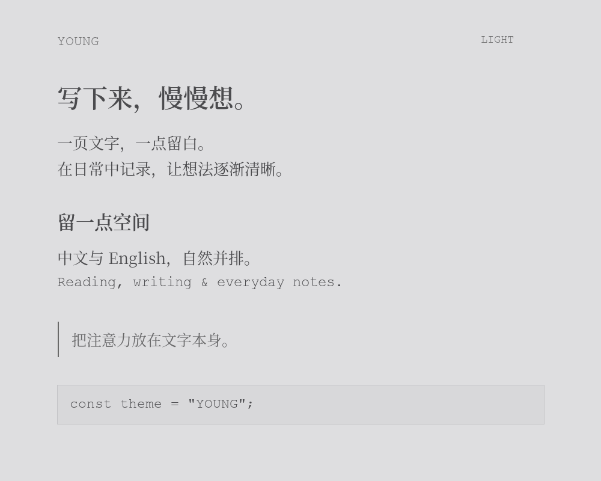
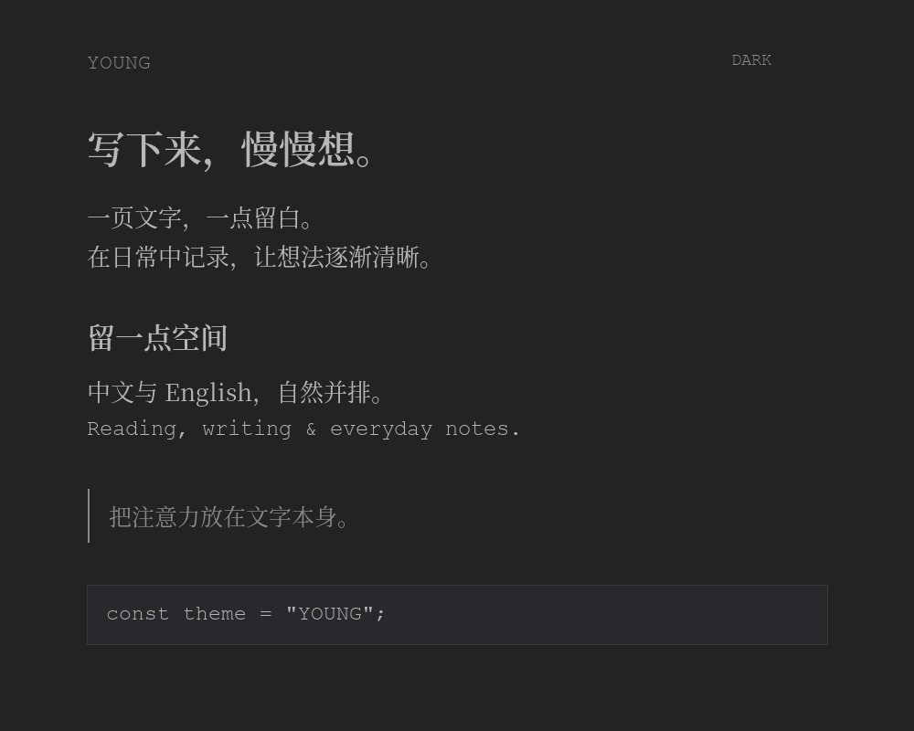

# YOUNG — Light & Dark for Typora

A quiet pair of Typora themes for Simplified Chinese and English writing, with soft grayscale colors, serif Chinese typography, Courier New Latin text, and a narrow writing column.

| Theme | Background | Text |
| --- | --- | --- |
| Young Light | `#dedee0` | `#4b4b4e` |
| Young Dark | `#232324` | `#b7b7ba` |

## Typography previews

## Install

1. [Download the theme](https://github.com/ZiyanLo/young-typora/archive/refs/heads/main.zip) and unzip it.
2. In Typora, open **Preferences → Appearance → Open Theme Folder**.
3. Copy `young-light.css`, `young-dark.css`, and the entire `young-fonts/` folder into the theme folder.
4. Restart Typora and select **Young Light** or **Young Dark**.

The font folder is required. ZYAN Ming is a renamed, OFL-licensed WOFF2 conversion of Adobe Source Han Serif SC, supplied in Regular and SemiBold. Courier New is a system fallback and is not redistributed. If Courier New is unavailable, Latin text uses the browser fallback.

## Features

- 15px body text, 1.5 line height, and a 680px writing column.
- Matched light and dark palettes for writing, tables, code, and sidebar.
- Consistent sidebar text with clean two-line file previews.
- Light text-stroke enhancement for slightly heavier text.
- White-background print layout.

Designed and used on macOS. Browser rendering checked; Windows and Linux have not been tested. Native macOS window-title typography is outside the theme CSS.

## 简体中文

柔和灰阶的深浅主题，中文使用思源宋体（主题内名 ZYAN Ming），英文优先使用系统 Courier New。安装时请同时复制两个 CSS 和完整 `young-fonts` 文件夹，不能只复制 CSS。侧栏摘要完整显示两行，顶部横向分隔线已隐藏。

## Font licensing

Bundled fonts are licensed under SIL OFL 1.1. See `young-fonts/OFL.txt` and `young-fonts/NOTICE.txt` for license and source details.
